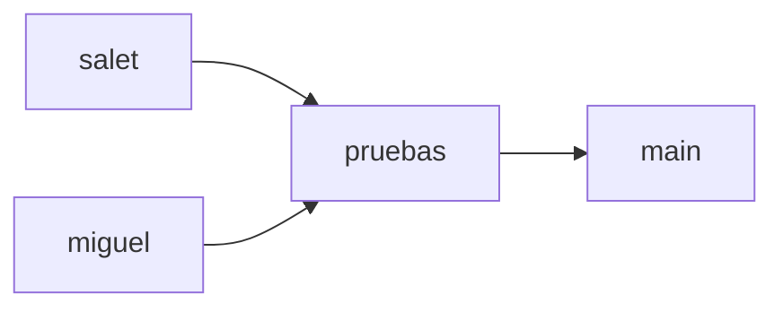

# Cuatro ramas para VestiNova

Acuerdo del 25 de octubre de 2026. Repositorio público previsto: `saletty/VestiNova`. Propietario: `saletty`; compañero invitado previsto: `jerezsuarezmiguelangel011-max`.

| Rama | Uso propuesto |
| --- | --- |
| `main` | Versión integrada y validada para presentar. Rama predeterminada. |
| `pruebas` | Integración y comprobación del trabajo de ambos integrantes. |
| `salet` | Trabajo de Saletty: autenticación y gestión de productos. |
| `miguel` | Trabajo de Miguel: catálogo público y detalle de producto. |

Son ramas del mismo repositorio, no carpetas o copias de las aplicaciones. El nombre de una rama no restringe por sí solo quién puede escribir en ella. No se configuraron reglas de protección ni permisos de ramas desde esta preparación.

## Creación inicial: la ejecuta el usuario

El Git local aún tiene `master` sin commits ni remoto. Primero se revisan archivos y se crea el commit inicial siguiendo [PUBLICACION_GITHUB.md](PUBLICACION_GITHUB.md). **No se pueden crear las cuatro ramas reales hasta que exista ese commit.** Después se ejecutan allí:

```powershell
git branch -m main
git branch pruebas main
git branch salet main
git branch miguel main
git push -u origin main pruebas salet miguel
gh repo edit saletty/VestiNova --default-branch main
git ls-remote --heads origin
```

Este bloque es un resumen de los pasos iniciales, no debe repetirse si ya se ejecutaron en la guía completa. Si una rama o remoto ya existe, detenerse y revisar; no sobrescribirlo. Las cuatro ramas empezarán apuntando al mismo commit ejecutable. `-u` fija la rama remota de seguimiento para cada rama publicada. [Referencia de git push](https://git-scm.com/docs/git-push).

## Trabajo de Saletty

En la carpeta actual del MVP, después de publicar las cuatro ramas:

```powershell
Set-Location 'C:\Users\Personal\Downloads\VestiNova\vestinova-mvp'
git status --short
git switch salet
git pull --ff-only origin salet
```

No cambiar de rama con cambios sin revisar. Los commits de avance deben incluir todos los archivos necesarios y excluir secretos, dependencias y compilados. Al terminar un avance verificado, publicar la rama con `git push origin salet` y proponer un PR hacia `pruebas`:

```powershell
gh pr create --repo saletty/VestiNova --base pruebas --head salet --web
```

## Incorporación de Miguel

Primero debe aceptar la invitación enviada a `jerezsuarezmiguelangel011-max`. En **su computadora**, desde la carpeta donde quiera guardar el proyecto y donde todavía no exista una carpeta `VestiNova`:

```powershell
git clone https://github.com/saletty/VestiNova.git
Set-Location VestiNova
git switch --track origin/miguel
git status -sb
```

Si ya tiene el clon y una rama local `miguel`, usar `git switch miguel` en lugar de crearla otra vez. Cada integrante configura su propio entorno y `.env` siguiendo el README; no compartir credenciales PostgreSQL ni copiar la base del otro.

Después de sus commits y pruebas, publicar con `git push origin miguel` y proponer el PR:

```powershell
gh pr create --repo saletty/VestiNova --base pruebas --head miguel --web
```

## Integración y presentación



Revisar cada avance antes de fusionarlo hacia `pruebas`. Ejecutar las pruebas de backend, frontend y PostgreSQL que correspondan y comprobar la integración. Cuando ese estado esté validado, proponer:

```powershell
gh pr create --repo saletty/VestiNova --base main --head pruebas --web
```

El título, descripción y validaciones del PR deben reflejar el avance real; `--web` abre el formulario para completarlos. No se crearon PR durante esta preparación. [Comando oficial de PR](https://cli.github.com/manual/gh_pr_create).

Conservar las cuatro ramas después de fusionar: no usar la eliminación automática de ramas ni el botón de borrar rama. Antes del siguiente avance se pueden traer los cambios integrados con un merge normal, desde la rama personal y con el árbol de trabajo limpio:

```powershell
git fetch origin
git merge origin/pruebas
```

Si aparecen conflictos o el push es rechazado, revisar e integrar los cambios sin reescribir el historial remoto. La rama `pruebas` no es otra base de datos: los datos locales siguen fuera de Git y cada instalación aplica sus migraciones.

El móvil sigue pendiente de procedencia, alcance y adaptación, sin asignación nueva a ninguno de los integrantes por crear estas ramas.
